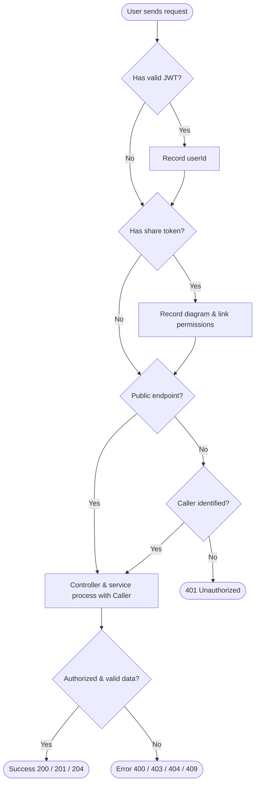
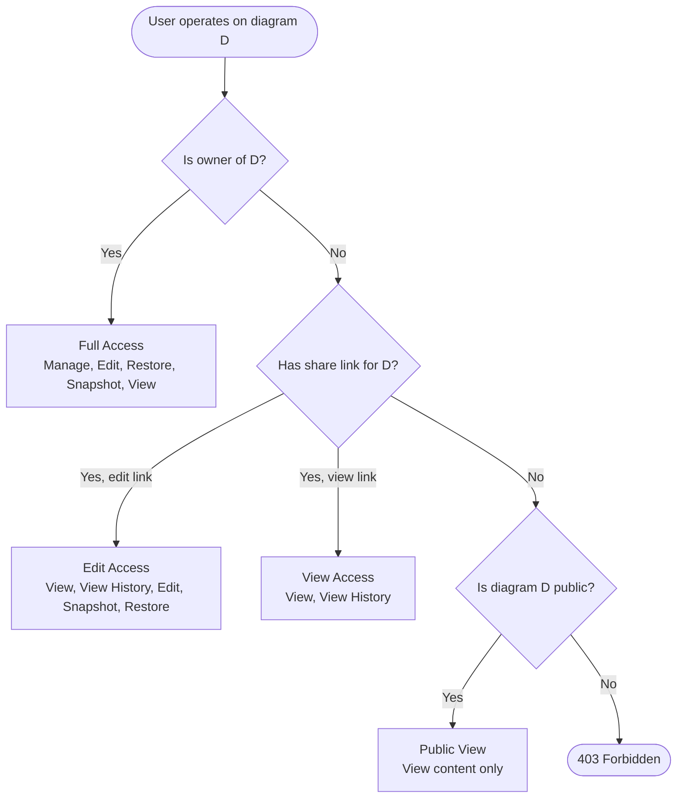
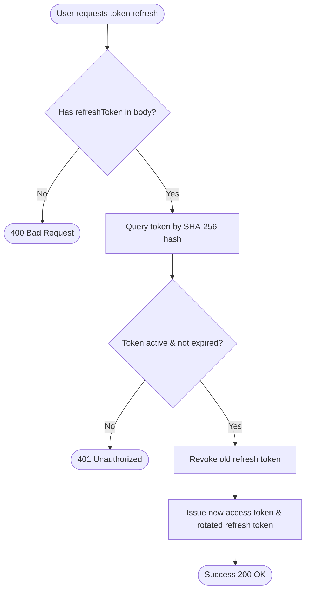
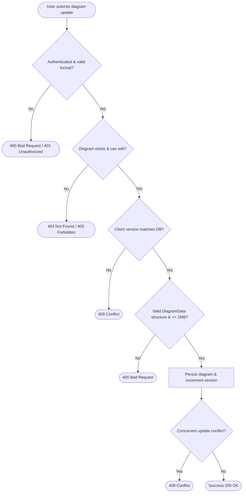
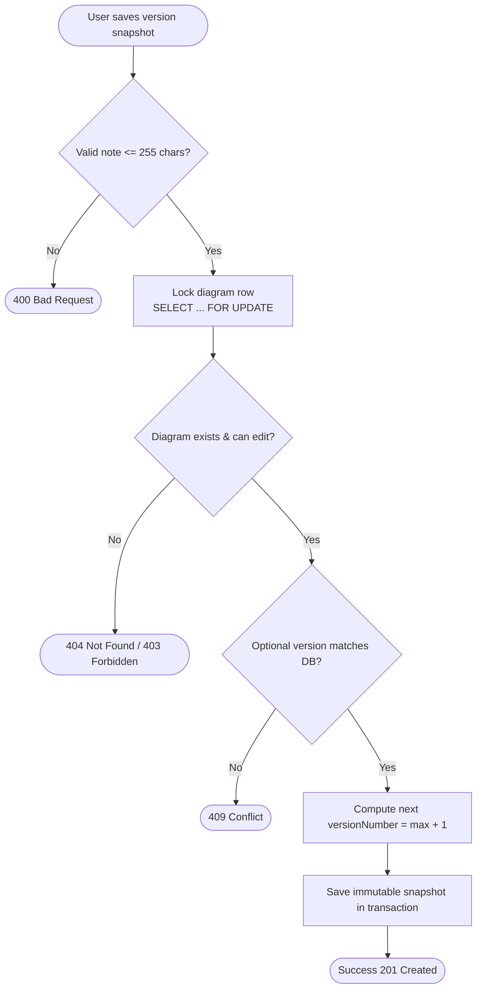
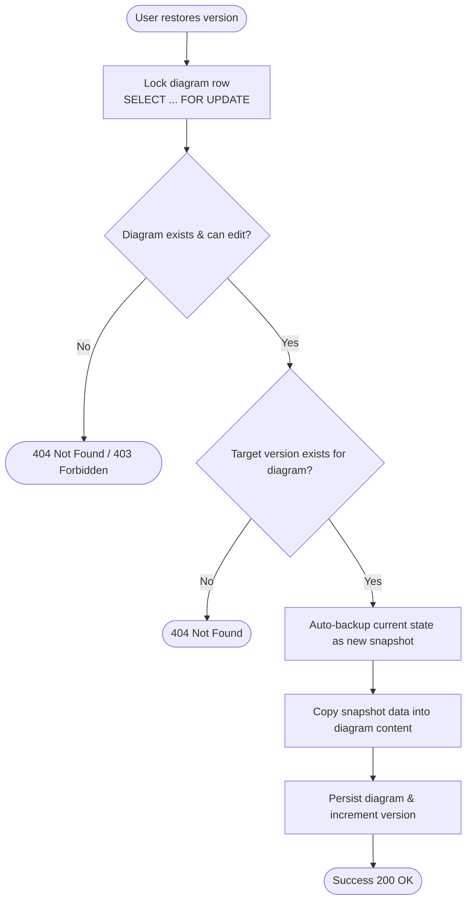
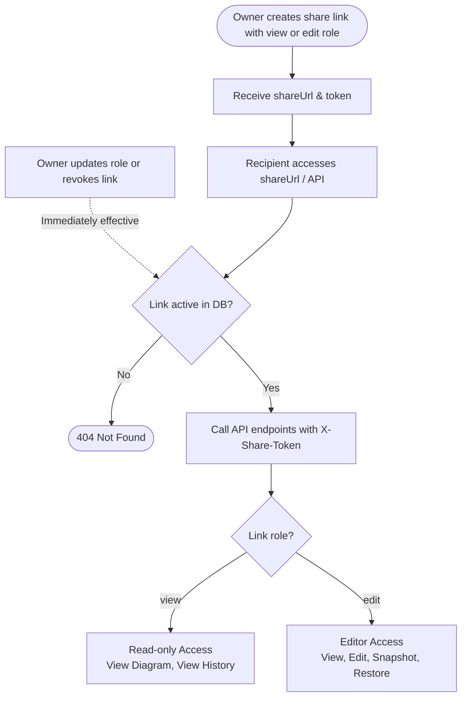

# Core Business Workflows

This document specifies the primary execution flows of DiagramIO. Standard CRUD actions (such as user registration, login, profile retrieval, password modification, diagram creation, and simple diagram deletion) are documented directly in [openapi.yaml](openapi.yaml) and the Swagger UI.

1. [Request Authentication Flow](#1-request-authentication-flow)
2. [Caller-Based Authorization](#2-caller-based-authorization)
3. [Token Refresh & Rotation](#3-token-refresh--rotation)
4. [Diagram Update (Optimistic Locking)](#4-diagram-update-optimistic-locking)
5. [Version Snapshot Creation](#5-version-snapshot-creation)
6. [Version Restoration](#6-version-restoration)
7. [Share Link Lifecycle](#7-share-link-lifecycle)

All API endpoints are prefixed with `/api/v1`. On failure, the service returns a standard JSON error envelope containing `timestamp`, `status`, `error`, `message`, and `path`. Data remains unchanged on errors.

| HTTP Code | Trigger Condition |
|---|---|
| **400** | Invalid payload: missing fields, malformed structure, `data` JSON invalid, `note` > 255 characters, `size` > 100 |
| **401** | Unauthenticated: missing/invalid/expired JWT or share token; invalid login credentials; reused/invalid refresh token; rejected on a diagram when the caller possesses neither an account nor a link |
| **402** | Payment Required (not used) |
| **403** | Forbidden: caller identity is recognized (authenticated user or valid share token) but lacks required permissions |
| **404** | Not Found: diagram, version, share link not found, or share token was revoked |
| **409** | Conflict: optimistic locking version mismatch, duplicate email or username |

---

## 1. Request Authentication Flow

**Scope:** Evaluated on every incoming HTTP request.

Each request passes through two security filters prior to reaching a controller:
1. `JwtAuthenticationFilter`: Extracts and validates `Authorization: Bearer <accessToken>`.
2. `ShareTokenFilter`: Extracts and resolves `X-Share-Token: <shareToken>`.

Neither filter unilaterally rejects requests; they populate authentication context. The endpoint's access rules in `SecurityConfig` decide whether unauthenticated calls result in `401 Unauthorized`. The resolved identity is encapsulated in a domain `Caller` object.

- A valid JWT must possess a valid signature and must not be expired (15-minute TTL).
- A valid share token must be present in the `X-Share-Token` header and exist actively in `diagram_shares`.
- Public endpoints include: `/auth/register`, `/auth/login`, `/auth/refresh-token`, `/health`, `/shares/{token}`, `/diagrams/public`, and `GET /diagrams/{id}`. For `GET /diagrams/{id}`, unauthenticated callers reach the controller, and domain authorization decides if the diagram is publicly readable.
- If an authenticated user also supplies an `X-Share-Token`, both contexts merge into the `Caller`. Thus, an owner accessing their own share link retains owner privileges, and authenticated editors are tracked in `updated_by`.
- Share tokens are evaluated against the database on each request; revoking a link takes effect immediately on the next call.

---

## 2. Caller-Based Authorization

**Scope:** All operations targeting a specific diagram.

Authorization logic resides within `domain/access/Caller`. Domain services invoke `DiagramAccess.require(diagramId, caller, Permission)` (`VIEW`, `VIEW_HISTORY`, `EDIT`, `MANAGE`). Services do not differentiate whether a caller arrived via JWT or a share link.

- **Owner:** Full control. Can view, edit, snapshot, restore, delete the diagram, change `isPublic`, and manage share links.
- **Editor via Share Link:** Can view content, view version history, modify diagram data, create snapshots, and restore versions. Cannot delete diagram, change `isPublic`, or manage share links.
- **Viewer via Share Link:** Can view diagram content and view version history.
- **Public Caller:** Can view current diagram content only. Version history is restricted to prevent exposing historical drafts that may have contained private information prior to publishing.
- A share link generated for Diagram A conveys zero permissions for Diagram B.

---

## 3. Token Refresh & Rotation

**Endpoint:** `POST /api/v1/auth/refresh-token`

Access tokens expire in 15 minutes. Refresh tokens expire in 7 days and follow strict **single-use rotation**: each refresh invalidates the used refresh token and issues a new pair. Only the SHA-256 hash of refresh tokens is stored in the database.

- Token lookup, revocation, and new token issuance execute inside an atomic database transaction via `TransactionRunner`.
- Submitting an already revoked or non-existent token yields `401 Unauthorized`.
- Logout (`POST /api/v1/auth/logout`) marks the submitted token `revoked = true`.

---

## 4. Diagram Update (Optimistic Locking)

**Endpoint:** `PUT /api/v1/diagrams/{id}`

Multiple collaborators may edit the same diagram. Clients must send the `version` number currently displayed on their canvas. If another collaborator persisted changes in the interim, the update is rejected with `409 Conflict` to prevent overwriting.

- Two layers protect against lost updates:
  1. Application-level check: `diagram.version() == request.version()`.
  2. JPA `@Version` concurrency check during SQL `UPDATE`: `WHERE id = ? AND version = ?`.
- `DiagramData` payload must represent a valid JSON object containing `nodes` and `edges` arrays and not exceed 2 MB.
- Only the owner may alter `isPublic`. If an editor via share link attempts to toggle `isPublic`, the existing value is preserved.
- When `409 Conflict` is returned, clients reload the latest diagram state via `GET /api/v1/diagrams/{id}` before re-applying edits.

---

## 5. Version Snapshot Creation

**Endpoint:** `POST /api/v1/diagrams/{id}/versions`

A snapshot captures an immutable copy of diagram `data` at a given point in time. Snapshots receive sequential numbers (1, 2, 3...) per diagram.

- Executed within an atomic transaction with a pessimistic row lock (`SELECT ... FOR UPDATE`) on the target diagram. Concurrent snapshot requests on the same diagram queue up deterministically without sequence collisions.
- Database uniqueness constraint `UNIQUE (diagram_id, version_number)` serves as final data-integrity guard.
- The optional `version` field ensures users snapshot the exact state they intend rather than an interleaved update from another user.

---

## 6. Version Restoration

**Endpoint:** `POST /api/v1/diagrams/{id}/versions/{version_id}/restore`

Restoration replaces the diagram's active `data` with the content of a historical snapshot. The current state is automatically snapshotted first to guarantee reversibility.

- Both auto-backup creation and diagram overwrite execute inside a single transaction with pessimistic row locking (`SELECT ... FOR UPDATE`).
- Auto-backup notes follow the convention: `Auto backup before restoring version N`.
- Only `data` is restored; metadata (`title`, `diagramType`, `isPublic`) remains untouched. Historical snapshots are immutable and never modified or deleted.

---

## 7. Share Link Lifecycle

**Endpoints:**
- `POST /api/v1/diagrams/{id}/shares` (create link)
- `GET /api/v1/shares/{token}` (resolve link & retrieve diagram)
- `PATCH /api/v1/diagrams/{id}/shares/{share_id}` (change role)
- `DELETE /api/v1/diagrams/{id}/shares/{share_id}` (revoke link)

- Share tokens are cryptographically random 24-byte hex strings (48 characters).
- Only the diagram owner can create, modify, or revoke share links.
- Revocation permanently deletes the link from `diagram_shares`. Any subsequent requests using that token immediately fail with `404 Not Found`.
- Unauthenticated callers using a share link have `created_by` and `updated_by` recorded as `NULL`.
