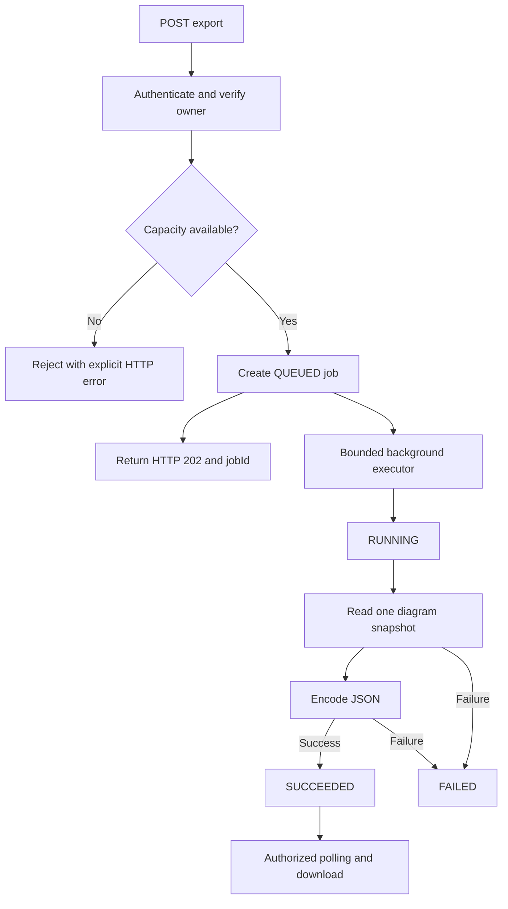

# DiagramIO – Step 7: Async JSON Export Architecture

**Branch:** `feature/phase2-concurrency`
**Status:** Design proposal — implementation begins in Step 8
**Scope:** Single DiagramIO backend instance, authenticated owner export, JSON format.

## 1. Current code and motivation

- `DiagramService.getDiagramById(UUID, Caller)` uses `DiagramAccess.require(..., Permission.VIEW)` to enforce read authorization.
- The existing `Diagram` entity contains `title`, `diagramType`, `data`, and `version` (fields used by the current update/read workflow).
- There is no export controller, export job, asynchronous worker, or execution pool in the currently inspected backend.
- An inline synchronous export would keep the HTTP request active while generating the result and make overload difficult to isolate.

**Quality goals**

1. `POST` validates identity and access, admits a bounded job, and returns `202 Accepted` with a job ID without waiting for rendering.
2. Work is executed on dedicated background workers, separate from the HTTP request threads.
3. Worker and queue concurrency are bounded; a full queue produces an explicit, testable rejection.
4. Users cannot see or download someone else's job/result.
5. Job state, execution time, failures, and rejection counts are measurable.

## 2. MVP scope and policy

- **Format:** `application/json`, UTF-8. Export a portable document containing `diagramId`, `title`, `diagramType`, `version`, `exportedAt`, and `data` (with JSON `nodes` and `edges`). Avoid PDFs, SVG, and images in the initial implementation.
- **Authorization:** The MVP requires an authenticated **diagram owner**. Request creation verifies the caller's owner identity before admission. Status and download require the same authenticated job owner. A later extension may support shared viewers, but must also handle live share-token revocation.
- **Persistence:** In-memory job registry and output bytes. Results are **not durable** across backend restarts. The API must document this limit rather than implying guaranteed delivery.
- **Limits:** Suggested initial configuration: 2 worker threads; queue capacity 20; job-retention TTL 10 minutes; max result bytes 3 MiB; maximum retained jobs 40. These are *proposed tunable values*, not existing settings or measured optimal values.
- **Snapshot consistency:** Worker loads an immutable snapshot at processing time and builds the output from that single read. A version may change between admission and processing; the exported `version` reports the actual snapshot used. Do not combine fields from multiple reads.
- **Security at download:** The job result is accessible only to the authenticated creator. If the original diagram has been deleted or the creator no longer owns it, deny download according to a documented policy; do not hand out raw files through unprotected paths.

## 3. Endpoints (new, proposed)

| Method and route | Input | Response | Semantics |
| --- | --- | --- | --- |
| `POST /api/v1/diagrams/{id}/exports` | Bearer access token | `202`, `{jobId, status:"QUEUED", statusUrl}` | Verify authenticated ownership and atomically admit to queue. |
| `GET /api/v1/exports/{jobId}` | Bearer access token | `200`, job status | Only creator may poll; `404` for unknown or inaccessible job. |
| `GET /api/v1/exports/{jobId}/download` | Bearer access token | `200` JSON attachment | Only after `SUCCEEDED`; `409` while incomplete; `410` if expired (or `404`, if obscuring existence). |

Overload: reject new `POST` calls with `429 Too Many Requests` or `503 Service Unavailable` (**choose one consistently in Step 8**); supply `Retry-After` where practical. Reject before returning `202`; never silently drop an accepted job.

## 4. State machine and flow

States: `QUEUED -> RUNNING -> SUCCEEDED | FAILED`. Expired completed jobs are removed by cleanup. Capture safe error codes/messages without serializing tokens or passwords.

**Submission atomicity:** Capacity check and executor submission must be coordinated. A rejected `execute()`/`submit()` must remove the proposed job from the registry (or mark it REJECTED without suggesting it was accepted). Do not perform a non-atomic queue-size check followed by unconditional submission.

## 5. Candidate Java components (Step 8)

| Component | Responsibility |
| --- | --- |
| `ExportController` (`api/export`) | POST, status, download HTTP contract and authentication. |
| `ExportJobStatus`, `ExportJob` (`domain/export`) | Immutable IDs, status transitions and timestamps. |
| `ExportJobService` (`domain/export` or application layer) | Access checks, admission, state tracking, result lookup and cleanup. |
| `ExportExecutorConfig` (`config`) | Bounded `ThreadPoolTaskExecutor` or `ThreadPoolExecutor`, explicit rejection policy. |
| `JsonDiagramExporter` (`infrastructure/export`) | Serialize a single diagram snapshot; no HTTP coupling. |
| `ExportJobServiceTest`, `ExportControllerTest`, `ExportConcurrencyTest` | Permissions, API contract, queue saturation, status transitions, failures. |

**Dependency rule:** Do not pass a mutable request-scoped `Caller`, SecurityContext, or raw bearer token into background jobs. Store the authenticated creator ID and diagram ID, then read through a clearly defined, authorized service boundary. The worker should not assume it inherits the HTTP security context.

## 6. Observability and resilience

- Counters: `exports.submitted`, `exports.succeeded`, `exports.failed`, `exports.rejected`.
- Gauges: `exports.active_workers`, `exports.queue_depth`, `exports.retained_results`.
- Timer: `exports.duration` measured from `RUNNING` to terminal state; track queue wait separately.
- Log `jobId`, diagram ID, status and duration; never log access/refresh/share tokens or full JSON payloads.
- Worker exceptions must end the job as `FAILED` and free worker capacity. Queue admission failure must not affect GET diagram/share endpoints.
- Add TTL- and size-based cleanup to avoid unbounded retained outputs. Limits are per application instance; no distributed coordination in MVP.

## 7. Acceptance checklist and evidence

| Test | Expected result |
| --- | --- |
| Authorized owner submits export | `202` with unique job ID; request returns before job finishes. |
| Poll status | `QUEUED/RUNNING` then `SUCCEEDED`; output has matching diagram ID and snapshot version. |
| Download | `application/json` with attachment header and valid `nodes`, `edges`. |
| Unauthenticated or non-owner request | `401/403/404` by the project's security policy. |
| Other user polls/downloads job | Denied; no data leak. |
| Worker throws | Job becomes `FAILED`; later jobs still run. |
| Executor saturated | New job gets explicit overload HTTP code; accepted jobs are not lost. |
| Many concurrent submissions | Active workers never exceed configured bound; queue remains bounded. |
| Application restart | In-memory job limitation is explicit; old job IDs no longer available. |
| Full Gradle test suite | `BUILD SUCCESSFUL`. |

## 8. Tradeoffs and next steps

- JSON output is less visually appealing than PNG/PDF but keeps the experiment focused on concurrency/resilience and avoids native rendering dependencies.
- A single JVM registry is simple to test but not restart-safe or horizontally scalable. Production-grade follow-up: persistent job table, durable queue, object storage, idempotency, cleanup and retries.
- If export must be allowed for share-link viewers, choose a security model that revalidates authorization before download and handles revoked grants.
- **Step 8:** Implement basic job state machine, authorization, API and exporter.
- **Step 9:** Enforce bounded execution, rejection, and isolation (bulkhead).
- **Step 10:** Verify concurrency and failure behavior.
- **Step 11:** Add metrics/monitoring.
- **Step 12:** Repeat controlled Before/After benchmark with identical workloads.
