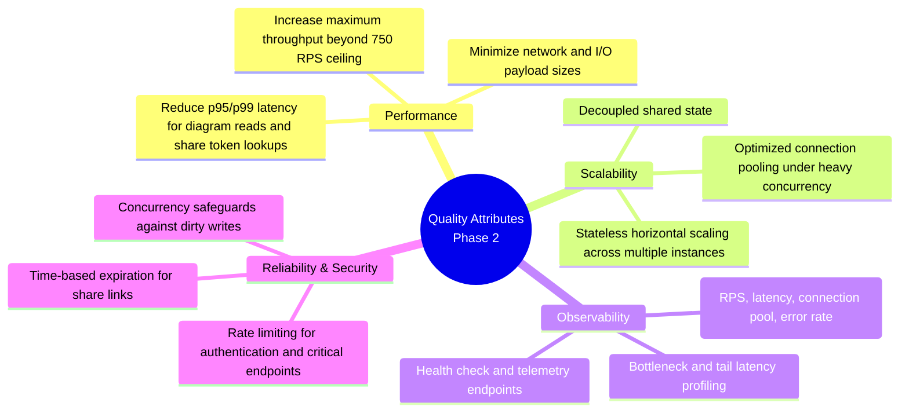
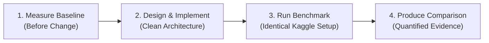

# Phase 2 Quality Attributes Strategy

This document establishes the quality attribute objectives, scenarios, and benchmarking methodology for Phase 2 of DiagramIO, aligned with course requirements defined in `2026.md`.

---

## 1. Context & Course Requirements (2026.md)

- **Phase 2 Goal:** Build upon the baseline system delivered in Phase 1 to propose, implement, and validate architectural improvements driven by Quality Attributes.
- **Core Requirements:**
  1. Propose suitable architectural patterns based on system evaluations and domain constraints.
  2. **Empirical Before & After evaluation is mandatory:** Every architectural change must explicitly state its rationale and show empirical evidence comparing performance before and after the modification.
  3. **Fixed hardware baseline:** All load tests and benchmarks must be executed on the **Kaggle Notebook CPU** (4 vCPU, 31 GB RAM) to eliminate external hardware and network variances.
  4. Each team member independently selects suitable technologies and tactics for their assigned quality attribute, provided they respect Clean Architecture boundaries (pure Java in the `domain` layer).

---

## 2. Quality Attributes Utility Tree

Phase 2 focuses on four primary quality attributes:

### Quality Attribute Scenarios

| Attribute | Stimulus | Environment | Expected Response | Measure |
|---|---|---|---|---|
| **Performance (Read)** | 100 concurrent users call `GET /api/v1/shares/{token}` or fetch diagram data | Kaggle CPU, high load | High cache-hit ratio, reduced database load | p95 latency < 30 ms (down from baseline 110 ms) |
| **Performance (Listing)** | Users with many diagrams invoke `GET /api/v1/diagrams` | Kaggle CPU | Avoid loading heavy `data` column (up to 2 MB); optimized count/pagination | >80% reduction in memory allocation and response payload size |
| **Scalability** | Incoming traffic exceeds single-instance capacity (~750 RPS) | Multi-instance behind Load Balancer | Even request distribution, seamless session handling | Near-linear throughput increase proportional to instance count |
| **Observability** | Executing load test or operating service | Kaggle CPU | Metrics on response times, database connection pool usage, and error rates exported continuously | Real-time monitoring metrics visible in Prometheus/Actuator |
| **Security & Reliability** | Repeated invalid login attempts or excessive API bursts | Kaggle CPU | Rate limit requests before reaching domain services | Return 429 Too Many Requests, protecting server resources |

---

## 3. Benchmark Environment & Baseline Reference

### Standard Hardware Environment
- **Environment:** Kaggle Notebook CPU
- **Hardware:** 4 vCPU, 31 GB RAM
- **Network:** `localhost:8080` (eliminates Internet network latency)
- **Tooling:** Headless Locust (or k6)

### Standard Load Test Scenario (Locust)
Each Virtual User executes:
1. One-time authentication upon start (`on_start`).
2. Continuous loop of 5 core business operations until the test run finishes:
   - Step 1: Create diagram (`POST /api/v1/diagrams`)
   - Step 2: Update diagram & Snapshot (`PUT /api/v1/diagrams/{id}`)
   - Step 3: Restore version (`POST /api/v1/diagrams/{id}/versions/{v_id}/restore`)
   - Step 4: Create share link (`POST /api/v1/diagrams/{id}/shares`)
   - Step 5: Access share link (`GET /api/v1/shares/{token}`)

### Phase 1 Baseline Reference (Commit `ca41f27`)

| Load Level (Users) | Total RPS | Total p95 (ms) | Total p99 (ms) | Error Rate | Observation |
|---|---|---|---|---|---|
| **10 Users** (Light) | 329.78 | 7 ms | 9 ms | 0.0% | Near-instant response |
| **50 Users** (Medium) | 736.22 | 46 ms | 56 ms | 0.0% | Optimal single-instance sweet spot |
| **100 Users** (Heavy) | 747.49 | 110 ms | 130 ms | 0.0% | CPU/Connection pool saturation ceiling |

---

## 4. Before & After Evaluation Discipline

Every architectural enhancement must follow this 4-step evaluation lifecycle:

### Comparison Template

When reporting results for any Phase 2 improvement, populate the standard verification table:

| Metric / Endpoint | Baseline (Before) | Post-Improvement (After) | Improvement (%) | Rationale / Key Driver |
|---|---|---|---|---|
| **Total RPS (100 users)** | 747.49 | *[new value]* | *[+X%]* | *[Tactic/technology applied]* |
| **Total p95 (100 users)** | 110 ms | *[new value]* | *[-X%]* | *[Reason for reduced latency]* |
| **Total p99 (100 users)** | 130 ms | *[new value]* | *[-X%]* | *[Tail latency reduction]* |
| **Error Rate** | 0.0% | *[new value]* | 0.0% | Data integrity preserved |

---

## 5. Candidate Architectural Directions

Derived from Section 7 of `README.md`. **Members independently choose their specific tactics and libraries**:

1. **Database & Query Optimization:**
   - Composite indexes, indexing `diagram_shares.diagram_id` and `diagrams.is_public`, and `pg_trgm` for diagram title search.
   - Projections avoiding the 2 MB `data` column during listing; combined count queries or keyset pagination.
2. **Caching & Payload Transfer:**
   - Caching read-intensive diagrams and decoded share tokens (in-memory or distributed cache).
   - Strict cache eviction upon diagram mutation or share revocation.
   - Response body compression (gzip) for large JSON payloads.
3. **Horizontal Scalability:**
   - Multi-instance deployment behind a reverse proxy / load balancer (e.g. Nginx).
   - Tuning HikariCP connection pool parameters and container JVM options.
4. **Observability:**
   - Spring Boot Actuator and Prometheus telemetry to observe resource utilization and bottlenecks during load tests.
   - Request latency monitoring and profiling.
5. **Security & Resilience:**
   - Rate limiting on sensitive endpoints (`/auth/login`, `/auth/register`).
   - Token expiration on share links.
