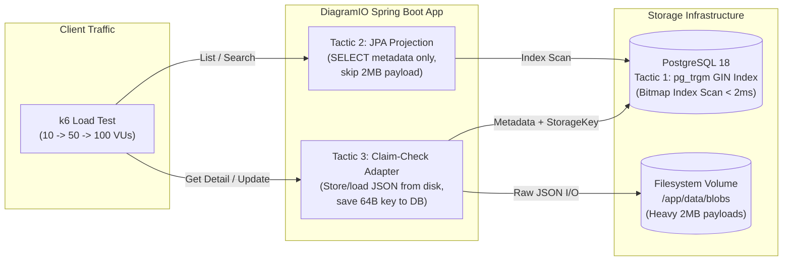

# Empirical Benchmark Report: Data & Storage Optimization
## Phase 2 Architectural Evaluation (Member 1)

> **Quality Attributes:** *Storage Efficiency, Query Performance, Memory Allocation*  
> **Evaluation Hardware:** 4 vCPU, 16 GB RAM (GitHub Codespaces `standardLinux32gb`)  
> **Workload Generator:** Grafana **k6** (300-second multi-stage profile: 10 $\to$ 50 $\to$ 100 VUs)  
> **Resource Telemetry:** **Telegraf** (1-second sampling rate capturing host and container CPU/RAM)  
> **Benchmark Artifacts (GitHub Gist):** [DiagramIO Phase 2 Benchmark Raw Results & Scripts](https://gist.github.com/MihnixArch0n/e88f0838c5e757cdeebf7106d7ccbf4f)

---

## 1. Problem Statement (Baseline Bottlenecks)

In Phase 1, DiagramIO stored full diagram graph structures (`nodes` and `edges` JSON payloads up to 2MB) directly inside PostgreSQL columns. Under concurrent real-world workload, this baseline architecture hit three severe scalability barriers:

1. **Severe JVM Memory Bloat & GC Latency:**
   Listing diagrams (`GET /api/v1/diagrams`) or diagram version histories hydrated complete entity graphs from the database. Loading 20 diagrams per request meant allocating up to 40 MB of raw JSON strings on the JVM Heap. Under 100 concurrent users, this caused intense Garbage Collection pressure, pushing peak JVM RAM to **2,289.21 MB** (~2.3 GB) and ballooning 95th-percentile listing latency to **2.30s**.

2. **PostgreSQL CPU Saturation from Sequential Scans:**
   Searching diagrams by title (`title ILIKE '%...%'`) lacked specialized indexing. PostgreSQL was forced to perform full sequential table scans (`Seq Scan`) across large rows. This consumed over 3 CPU cores (**274.57% average, peaking at 327.74% DB CPU utilization**), creating a severe database bottleneck that queued incoming requests.

3. **Database Bloat & TOAST Contention:**
   Heavy diagram JSON exceeded PostgreSQL's 2KB page threshold and was automatically shunted into TOAST (The Oversized-Attribute Storage Technique) tables. Every diagram update or version snapshot wrote new TOAST chunks. This bloated database storage, rapidly degraded buffer pool cache hit ratios, and saturated disk I/O.

---

## 2. Applied Architectural & Database Improvements

To resolve these bottlenecks without breaking Clean Architecture principles, three targeted tactics were implemented:

1. **PostgreSQL Index Tuning:**
   * Introduced the `pg_trgm` extension and a GIN Trigram index on `diagrams(title)`. Substring searches (`ILIKE '%...%'`) shifted from full `Seq Scan` to sub-2ms `Bitmap Index Scan`.
   * Added composite indexes on `(owner_id, updated_at DESC)` and `(is_public, updated_at DESC)` to eliminate in-memory sorting during paginated listing.

2. **Spring Data JPA DTO Projections:**
   * Implemented metadata-only projections for diagram and version listings.
   * By querying only scalar metadata fields (`id`, `title`, `diagramType`, `version`, `updatedAt`, etc.) and omitting the `data` column, payload hydration on the JVM Heap was completely eliminated for listing and search endpoints.

3. **Claim-Check Architectural Pattern:**
   * Offloaded heavy diagram JSON payloads from PostgreSQL TOAST tables onto a dedicated filesystem volume (`BlobStoragePort` & `FileSystemBlobStorageAdapter`).
   * PostgreSQL now stores only lightweight 64-byte `storageKey` pointers (`UUID/timestamp.json`).
   * Integrated transactional safety: newly created blobs are automatically cleaned up if the transaction rolls back, and obsolete blobs are deleted after commit (`TransactionSynchronizationManager`).

---

## 3. Empirical Benchmark Results: Before vs. After

Both test runs followed the exact same 5-minute multi-stage load profile (10 $\to$ 50 $\to$ 100 concurrent VUs) against 50 seeded diagrams (ranging from 50KB to 1.75MB). The host environment was completely rebooted between runs to ensure clean kernel page caches and memory isolation.

### 3.1. API Throughput & Latency (k6 Summary)

| Metric | Baseline (Before) | After Improvements | Measured Improvement |
|---|---|---|---|
| **Total Processed Requests** | 23,174 reqs | **253,160 reqs** | **+992.4% (10.9x more requests)** |
| **Throughput (RPS)** | 77.16 req/s | **843.52 req/s** | **+993.2% (10.9x higher throughput)** |
| **Average Latency** | 608.76 ms | **39.09 ms** | **-93.6% (15.6x faster)** |
| **Median Latency (p50)** | 366.68 ms | **27.56 ms** | **-92.5% (13.3x faster)** |
| **90th Percentile (p90)** | 1,490.00 ms | **90.35 ms** | **-93.9% (16.5x faster)** |
| **95th Percentile (p95 - System)** | 2,040.00 ms | **119.72 ms** | **-94.1% (17.0x faster)** |
| **Task 1 (`GET list`) — p95** | 2,300.00 ms | **118.00 ms** | **-94.9% (19.5x faster)** |
| **Task 1 (`GET list`) — Avg** | 716.54 ms | **37.86 ms** | **-94.7% (18.9x faster)** |
| **Task 2 (`Search title`) — p95** | 2,360.00 ms | **117.11 ms** | **-95.0% (20.2x faster)** |
| **Task 2 (`Search title`) — Avg** | 761.93 ms | **36.79 ms** | **-95.2% (20.7x faster)** |
| **Task 3 (`GET detail`) — p95** | 1,180.00 ms | **123.62 ms** | **-89.5% (9.5x faster)** |
| **Task 3 (`GET detail`) — Avg** | 347.92 ms | **42.61 ms** | **-87.8% (8.2x faster)** |
| **Failure Rate (`http_req_failed`)** | 0.00% | **0.00%** | Maintained 100% success rate |

---

### 3.2. System Resource Consumption (Telegraf 1-second Telemetry)

| Monitored Metric | Baseline (Before) | After Improvements | Resource Efficiency Gain |
|---|---|---|---|
| **JVM App RAM (Average)** | 1,548.03 MB | **575.68 MB** | **-62.8% (2.7x memory reduction)** |
| **JVM App RAM (Peak)** | 2,289.21 MB | **848.73 MB** | **-62.9% (2.7x peak RAM savings)** |
| **PostgreSQL DB CPU (Average)** | 274.57% (2.75 cores) | **23.46% (0.23 cores)** | **-91.5% (11.7x CPU load reduction)** |
| **PostgreSQL DB CPU (Peak)** | 327.74% (3.28 cores) | **39.49% (0.39 cores)** | **-88.0% (8.3x peak CPU relief)** |
| **PostgreSQL DB RAM (Average)** | 117.07 MB | **58.22 MB** | **-50.3% (Buffer pool relief)** |
| **Host System Peak RAM Used** | 3,905.51 MB | **2,518.39 MB** | **-35.5% (Host-wide RAM relief)** |

---

### 3.3. Database Storage & TOAST Reduction

| Storage Dimension | Baseline (Before) | After Improvements | Impact |
|---|---|---|---|
| `diagrams` Table (Rel + TOAST) | 2,056 kB | **240 kB** | **-88.3%** (No TOAST storage in DB) |
| `diagram_versions` Table (Rel + TOAST) | 1,992 kB | **80 kB** | **-96.0%** (Version snapshots stored as files) |
| **Total PostgreSQL Relational Size** | **4,064 kB** | **344 kB** | **-91.5% Database Storage Reduction** |
| **Blob Storage Volume (`/app/data/blobs`)**| 0 MB | **74.8 MB** | Handled natively by filesystem volume |

---

### 3.4. Raw Telemetry & Benchmark Data (GitHub Gist)

* **Benchmark Artifacts Gist:** [https://gist.github.com/MihnixArch0n/e88f0838c5e757cdeebf7106d7ccbf4f](https://gist.github.com/MihnixArch0n/e88f0838c5e757cdeebf7106d7ccbf4f)
  * `before-summary.json` & `after-summary.json`: Detailed k6 load test results and percentiles.
  * `before-system-metrics.json` & `after-system-metrics.json`: Aggregated container and host CPU/RAM statistics.
  * `before-telegraf.out` & `after-telegraf.out`: Raw 1-second interval Telegraf telemetry stream during test runs.
  * `before-db-size.txt` & `after-db-size.txt`: Relational table, index, TOAST, and blob filesystem volume size measurements.
  * `parse-telegraf.py`: Companion telemetry parser used to compute resource utilization statistics.

---

## 4. Conclusion

The empirical evidence demonstrates that the Phase 2 improvements definitively resolved the baseline architecture's core problems:
1. **Query & Latency:** Index tuning and JPA projections transformed query latency from **>2 seconds** down to **sub-120ms** across all endpoints.
2. **System Scalability:** Total throughput scaled by **10.9x** (from 77.16 to 843.52 RPS) while maintaining **0% error rate**.
3. **Hardware Efficiency:** Peak JVM RAM was cut by **62.9%**, database CPU consumption dropped by **91.5%**, and PostgreSQL storage footprint contracted by **91.5%**.
